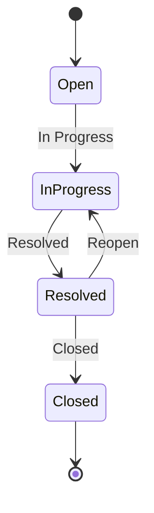

# Support CRM — Ticket Management

A Customer Support CRM module that keeps every customer request as a ticket with **one owner, a
clear status, and a full history**. A single support supervisor (there is no login) creates
tickets, lists and filters them, views details, assigns agents, moves tickets through a fixed
status flow, and adds internal notes.

Every change is written together with an append-only history entry in the same database
transaction, so a ticket's timeline can never drift from its current state.

## Scope

This repository implements the Ticket Management module **only**. The six user stories it covers
are: create a ticket, find tickets in a list, view ticket details, assign or reassign an owner,
move a ticket through its status flow, and add internal notes.

### Out of scope

Login and roles · SLA · email/WhatsApp/SMS channels · AI features · knowledge base ·
customer portal · reports · attachments · multi-branch · ticket deletion · agent management

Agents are predefined seed data and are not managed here. Ticket subject, description, category,
and priority are not editable after creation, and notes cannot be edited or deleted.

## How this was built

This project was built with Spec-Driven Development, using [GitHub Spec Kit](https://github.com/github/spec-kit)
and Claude Code.

The work ran in that order: **constitution → specify → plan → tasks → analyze → implement**. The
governing principles were written first, then the specification, then the technical plan, then the
task breakdown — and only then any code.

`/speckit-analyze` cross-checked the spec, plan, and tasks against the constitution *before a line
of code was written*. It found **2 critical issues** plus several inconsistencies and coverage
gaps. Each one was reviewed by hand and fixed, and a re-run confirmed critical issues went from
**2 → 0**.

Implementation then followed the task list: **42 tasks, done one at a time**, mostly test-first,
with each task its own commit. Every AI-assisted step is recorded in
[docs/ai-usage.md](docs/ai-usage.md) — what was asked, what was kept, what was changed during human
review and why, and how the result was verified.

Validation beyond the automated suites:

- **All 13 manual browser scenarios** in the quickstart passed, covering the list, filters, search,
  validation errors, the full status flow, notes, both not-found states, and the API-unreachable
  error state.
- **A 10,000-ticket performance check** (SC-007) against a scratch database: the list, the filtered
  search, and the detail endpoint each answered **well under the 2-second budget**.
- **Current test counts:** backend **179 passed (837 assertions)**; frontend **175 passed across 12
  test files**.

## Tech stack

| Layer | Technology |
|---|---|
| Backend | PHP 8.2+, Laravel 12 (JSON REST API) |
| Frontend | Vue 3.5 SPA, Vue Router 5, Pinia 4, Axios 1, Vite 8 (JavaScript, no TypeScript) |
| Database | MySQL 8 (WAMP) in development; SQLite `:memory:` in tests |
| Tests | PHPUnit 11 (feature + unit); Vitest 4 with @vue/test-utils and jsdom |
| Platform | Local Windows/WAMP — API on `:8000`, SPA on `:5173` |

There is no authentication. Axios is the only package added on top of the original scaffolds, and
it is used for the frontend's HTTP calls; no Composer packages were added.

**Architecture in one line:** controllers stay thin, Form Requests validate, a single
`TicketService` owns the business rules, backed enums are the source of truth for every value, and
API Resources shape every response.

## Prerequisites

- **PHP 8.2+** on your `PATH`
- **Composer**
- **Node.js** `^22.18` or `>=24.12`, with npm
- **MySQL 8+** (WAMP on Windows)

## Setup

Full step-by-step instructions, including the `.env` values and the WAMP database setup, are in
**[specs/001-ticket-management/quickstart.md](specs/001-ticket-management/quickstart.md)**.

Summary:

```powershell
# Backend — http://localhost:8000
cd backend
composer install
copy .env.example .env      # never commit .env
php artisan key:generate
# create the `support_crm` database (utf8mb4_unicode_ci), then:
php artisan migrate:fresh --seed   # 5 agents, 10 customers, 30 tickets
php artisan serve

# Frontend — http://localhost:5173
cd frontend
npm install
npm run dev
```

## API

Eight endpoints, all under `/api`. Request and response shapes, validation messages, and error
bodies are documented in
**[specs/001-ticket-management/contracts/api.md](specs/001-ticket-management/contracts/api.md)**.

| Method | Endpoint | Purpose |
|---|---|---|
| `GET` | `/api/meta` | Statuses, priorities, categories, and allowed transitions, built from the enums |
| `GET` | `/api/agents` | The agent list used by the assign form |
| `GET` | `/api/tickets` | List with status/priority/category filters, search, and 15-per-page pagination |
| `POST` | `/api/tickets` | Create a ticket, reusing an existing customer by email |
| `GET` | `/api/tickets/{id}` | Full detail: customer, agent, notes, and history |
| `PATCH` | `/api/tickets/{id}/assign` | Assign or reassign the owning agent |
| `PATCH` | `/api/tickets/{id}/status` | Move the ticket to the next allowed status |
| `POST` | `/api/tickets/{id}/notes` | Add an internal note |

Conventions: `POST` returns `201`. Validation failures and business-rule failures both return
`422` as `{message, errors}`. Any `api/*` miss returns JSON `404`, never an HTML error page.

## Status flow

`TicketStatus` owns the transitions, and the API advertises the legal next moves per ticket in
`allowed_transitions`, so the UI only ever renders buttons the backend will accept.



Two rules guard the flow beyond the diagram:

- **An agent is required** to move a ticket to *In Progress*. Attempting it on an unassigned
  ticket returns `422` with *"Assign an agent before moving the ticket to In Progress."*
- **Closed is terminal.** A closed ticket accepts no status change, assignment, or note; a forced
  API call returns `422` with *"Closed tickets cannot be changed."*

## Running the tests

```powershell
cd backend;  php artisan test              # PHPUnit — SQLite in memory, no MySQL needed
cd frontend; npm run test:unit -- --run    # Vitest
```

Backend feature tests map 1:1 to the acceptance scenarios in the spec, and `TicketStatusTest`
unit-tests every from→to status pair.

Linting and formatting:

```powershell
cd backend;  vendor\bin\pint               # add --test to check without writing
cd frontend; npm run lint                  # oxlint + eslint
```

## Project structure

```text
backend/                 Laravel 12 API
├── app/
│   ├── Enums/           TicketStatus (owns transitions), TicketPriority, TicketCategory,
│   │                    TicketHistoryEvent — the source of truth for every value
│   ├── Exceptions/      TicketRuleException — renders rule failures as 422 field errors
│   ├── Http/
│   │   ├── Controllers/Api/   Ticket, TicketAssignment, TicketStatus, TicketNote, Agent, Meta
│   │   ├── Requests/          validation for every input, list filters included
│   │   └── Resources/         shapes every response body
│   ├── Models/          Customer, Agent, Ticket, TicketNote, TicketHistory
│   └── Services/        TicketService — all business rules, each mutation in a transaction
├── database/            factories, migrations, seeders (5 agents, 10 customers, 30 tickets)
├── routes/api.php       the 8 routes above
└── tests/               Unit/ (enums, transitions) and Feature/ (one file per user story)

frontend/                Vue 3 SPA
├── src/
│   ├── api/             http.js (axios + error normalizer), tickets.js, meta.js
│   ├── stores/          tickets.js — the single Pinia store
│   ├── router/          /tickets, /tickets/new, /tickets/:id, catch-all
│   ├── pages/           TicketList, TicketCreate, TicketDetail, NotFound
│   ├── components/      filters, pagination, status badge/actions, assign + note forms,
│   │                    history list, field errors, StateMessage (loading/empty/error + retry)
│   └── utils/           format.js — date formatting via Intl
└── src/__tests__/       mirrors src/ — api, stores, components, pages

docs/ai-usage.md         the Constitution X AI-usage log
specs/001-ticket-management/   spec, plan, contracts, data model, quickstart, tasks
```

All HTTP goes through `src/api/`, every view handles loading, empty, error, and 404 states, and
all user text is rendered with `{{ }}` as plain text — never `v-html`.

## Project documents

| Document | What it covers |
|---|---|
| [Constitution](.specify/memory/constitution.md) | The ten governing principles and the quality gates |
| [Specification](specs/001-ticket-management/spec.md) | User stories, acceptance scenarios, requirements, success criteria |
| [Implementation plan](specs/001-ticket-management/plan.md) | Tech stack, architecture, request flow, Constitution Check |
| [API contracts](specs/001-ticket-management/contracts/api.md) | Every endpoint's request and response shape |
| [Data model](specs/001-ticket-management/data-model.md) | Tables, columns, relationships, and rules |
| [Quickstart](specs/001-ticket-management/quickstart.md) | Setup, smoke checks, and the manual validation scenarios |
| [Tasks](specs/001-ticket-management/tasks.md) | The task breakdown this project was built from |
| [AI usage log](docs/ai-usage.md) | Every AI-assisted step: what was asked, kept, changed, and how it was verified |
